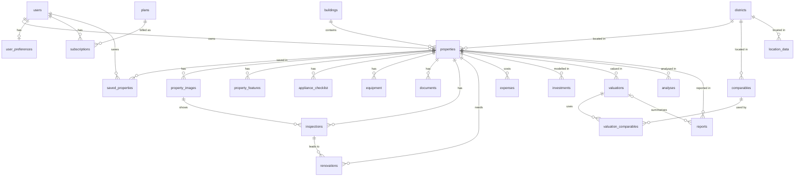

# Database

PostgreSQL 17 + PostGIS 3.5. Plain SQL migrations, named for Flyway (`V<n>__<name>.sql`) so the Spring Boot
backend can apply them on start-up, and runnable by hand with `psql`.

| File | What it does |
| --- | --- |
| [`migrations/V1__initial_schema.sql`](migrations/V1__initial_schema.sql) | Plans, users, subscriptions, districts, properties, analyses, saved comparisons |
| [`migrations/V2__evaluation_tables.sql`](migrations/V2__evaluation_tables.sql) | The full evaluation model: buildings, images, features, equipment, inspections, valuations, comparables, location data, expenses, renovations, investments, documents, saved properties, reports; profile and payment columns |
| [`migrations/V3__geo_search.sql`](migrations/V3__geo_search.sql) | PostGIS search functions, automatic district assignment, latest-valuation view |
| [`migrations/V4__property_submission.sql`](migrations/V4__property_submission.sql) | Property submission: purchase or rental, construction type, cooling, energy certificate, appliance checklist, photo areas and limits, building expense fields, `property_submissions` view |
| [`tests/schema_test.sql`](tests/schema_test.sql) | Assertions for tables, indexes, constraints, generated columns, cascades and every geo search; runs in a rolled-back transaction |
| [`seeds/demo_seed.sql`](seeds/demo_seed.sql) | Demo data for local development (real Athens coordinates, invented names and prices, all tagged `[DEMO]` / `demo-seed`) |

## Running it

```bash
# Start PostGIS on port 5437. On the first start the migrations are applied automatically.
docker compose up -d db

# Tests (leave the database unchanged)
docker compose exec -T db psql -U property -d property_intelligence -v ON_ERROR_STOP=1 < database/tests/schema_test.sql

# Optional demo data
docker compose exec -T db psql -U property -d property_intelligence < database/seeds/demo_seed.sql
```

Migrations only run on an empty volume. After pulling new migrations, either recreate the volume
(`docker compose down -v && docker compose up -d db`) or apply the new files with `psql`.

CI applies every migration to a fresh PostGIS container, runs the tests, loads the seed twice (it must be
re-runnable) and runs the tests again alongside the seed data.

## Tables

| Table | What it stores |
| --- | --- |
| `users` | Accounts and profiles: email (unique, case-insensitive), role, phone, company, locale, avatar key |
| `user_preferences` | Mortgage assumptions and notification settings |
| `properties` | Property details: purchase or rental, type, size, rooms, floor, age, construction type, condition, energy certificate and class, heating, cooling, asking price (monthly rent for rentals, range checked per listing type), location point |
| `property_images` | Uploaded photographs: storage key, type, size, area (kitchen, bathroom, bedroom, living room, exterior, building entrance, other), order, one cover per property; at most 8 per area and 24 per property |
| `appliance_checklist` | One row per checklist item: refrigerator, washing machine, dishwasher, oven and stove, air conditioning (working / damaged / missing / unknown), heating (available / unavailable / unknown), furniture (included / partial / not included); allowed statuses are checked per item |
| `property_features` | Rooms, facilities and amenities, with quantity, area and condition |
| `equipment` | Appliances and furniture: brand, age, condition, included in sale, photo it was detected in |
| `buildings` | Building condition (structure, facade, roof, common areas), shared facilities, common charges (and whether they include heating), planned works; shared by several properties |
| `inspections` | Visual inspection findings: category, severity, confidence, image region, status; from the AI inspector or a person |
| `valuations` | Estimated value (low/mid/high), price per m², confidence, verdict, factors |
| `comparables` | Similar property records: sales, listings and rentals with location, size and price |
| `valuation_comparables` | Which comparables each valuation used, with distance, similarity and weight |
| `location_data` | Nearby facilities (pharmacies, schools, metro, bus, supermarkets, parks…) as geography points |
| `districts` | Area boundaries with reference sale and rent prices per m² |
| `expenses` | Purchase, rental and ownership costs; monthly and annual amounts are annualised automatically |
| `renovations` | Repair items with cost range, priority, status and expected value uplift; can link to the finding that caused them |
| `investments` | Rental scenarios: price, costs, financing, rent, occupancy; total investment and gross/net yield are generated columns |
| `documents` | Uploaded documents (title deed, energy certificate, permit…) and their review status, summary and findings |
| `saved_properties` | A user's saved properties, with label, note and price alert |
| `subscriptions` | Plan, status, billing period, payment status, provider reference, current period |
| `plans` | Free, Premium, Professional, Business |
| `reports` | Generated evaluation reports: type, format, language, status, storage key, headline summary |
| `analyses`, `comparisons`, `comparison_properties` | Full analysis results (JSONB) and saved side-by-side comparisons, from V1 |



## Design notes

- **Money** is `numeric(12,2)` in EUR (a `currency` column where a value could come from elsewhere). No floats.
- **Enumerations** are `text` + `CHECK`, matching the string unions in the frontend types. Adding a value is a
  one-line migration and the values read clearly in SQL.
- **Derived numbers that must never drift** are generated columns: `comparables.price_per_sqm`,
  `expenses.annual_amount`, `investments.total_investment`, `gross_yield_pct`, `net_yield_pct`. Values that need
  loan schedules (cash flow, ROI) are written by the backend calculator.
- **Cross-column rules** are constraints: estimate low ≤ mid ≤ high, cost low ≤ high, AI findings need a
  confidence, a ready report needs a file, purchase costs are one-off, a loan needs a rate and a term.
- **Deletes**: removing an account removes its properties and everything attached. Buildings and market
  records (`comparables`, `location_data`) are shared and stay; a comparable used by a valuation cannot be deleted.
- **Files** (photos, documents, reports) live in object storage; tables hold the key and metadata only.
- **Every foreign key has an index** for the lookups the app makes; the tests check this.

## Geographical search (PostGIS)

Locations are `geography(Point, 4326)`, so distances are in metres on the spheroid. Each function filters with
`ST_DWithin` (uses the GiST index) and orders with `<->` (index-assisted nearest neighbour).

| Function | Answers |
| --- | --- |
| `nearby_places(point, radius_m, categories[], limit)` | What is around this point? Nearest first. |
| `property_nearby_places(property_id, radius_m, categories[], limit)` | The same for a saved property |
| `nearest_by_category(property_id, categories[], max_m)` | Nearest pharmacy, supermarket, school, metro… one row each |
| `location_summary(property_id, radius_m)` | How many of each within walking distance, and the closest |
| `find_comparables(property_id, radius_m, listing_types[], size_tolerance, since, limit)` | Similar properties nearby, ranked by similarity (distance, size, bedrooms) |
| `geo_point(lon, lat)` | Helper to build a point |

A trigger sets `district_id` on properties, comparables and places from the district boundary that covers the point.

```sql
-- Pharmacies and metro stations within 800 m of a point in central Athens
SELECT name, category, distance_m
FROM nearby_places(geo_point(23.7348, 37.9755), 800, ARRAY['pharmacy', 'metro']);

-- With the demo seed loaded
SELECT * FROM nearest_by_category('d0000000-0000-4000-8000-0000000000a1');
--  category    | name                            | distance_m
--  pharmacy    | [DEMO] Pharmacy A               |      104.8
--  supermarket | [DEMO] Supermarket              |      119.2
--  bus-stop    | [DEMO] Bus stop                 |      146.7
--  school      | [DEMO] Primary school           |      262.5
--  park        | National Garden (demo entry)    |      936.9
--  metro       | Evangelismos metro (demo entry) |     1104.4
--  …

SELECT listing_type, size_sqm, price_per_sqm, distance_m, similarity
FROM find_comparables('d0000000-0000-4000-8000-0000000000a1');
```

Query plan for a radius search (`EXPLAIN`, with `enable_seqscan = off` because the demo table is too small for
the planner to bother with the index on its own):

```
Index Scan using location_data_location_gix on location_data l
  Index Cond: (location && _st_expand(p.location, '800'::double precision))
  Order By: (location <-> p.location)
```
